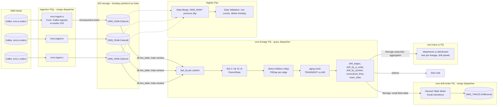

# 02 — Target architecture

The revised design for A → B → C order tracing on Deephaven Enterprise. It keeps the goals of
the source document and replaces its resolver / mapping-table / pending-buffer machinery with
one lineage DAG over durably ingested tables (doc 00 F2–F5). Requirement ids are doc 01's.

---

## 1. Design principles

1. **Ingest dumb, persist first, compute inside the engine.** Each system's feed lands in a
   Data Import Server as a partitioned intraday table before anything reads it (R1). All
   linking, reconciliation and aging are declarative table operations in one update graph;
   nothing stateful lives outside the engine.
2. **Pending is a state, not a place.** A child whose parent has not arrived is a row with
   `ParentState = UNRESOLVED`. It heals in the update cycle its parent lands (R8). Its
   durable copy is the raw table it was ingested into (R10).
3. **Reconcile per edge, attribute by edge.** Parent against Σ direct children; the edge
   names the system that missed the shares (R4, R5).
4. **One worker until a measured gate trips.** The whole lineage runs in one Core+ worker
   first. Sharding, when needed, is per edge by parent id and never requires a lookup before
   routing (doc 06).
5. **Cross-worker tables by the right mechanism.** Persisted tables through a DIS where
   history or replay matters; Barrage subscriptions only for small current-state tables
   (the Enterprise pipelining guidance; doc 00 F4).
6. **Everything is a PQ, every parameter is configuration, every script is in Git**
   (R14, N9; the sibling doc on Git-sourced PQ scripts).

## 2. Topology



Compared with the source document's figure: DIS-A/B/C become three ingester PQs that each
embed a DIS; the resolver worker, the mapping-table publisher, the pending-buffer PQ and the
reconciliation PQ are gone; the shard workers are a later phase of the same lineage PQ
(doc 06 §4), not a separate design.

## 3. Component inventory

| Component | Enterprise mechanism | State it owns | Heap class | Restart behaviour |
|---|---|---|---|---|
| `oms-ingest-a`, `-b`, `-c` | Core+ Kafka ingester in a "Live Query - Merge Server" PQ; in-worker DIS with private storage claiming `OMS_RAW.Orders<X>` | nothing beyond the DIS checkpoint (Kafka offsets, optional lastBy state) | small (2–4 GB; more with a lastBy view ∝ distinct orders) | resumes from the checkpoint offset; exactly-once |
| `OMS_RAW.OrdersA/B/C` | intraday partitions (`Date`) in DIS storage, served through the Table Data Service; merged nightly to historical | the raw history (R1, R10) | n/a (storage) | n/a |
| `oms-lineage` | Live Query (Script) PQ, Core+ Python | the lineage DAG (doc 04): last state per order, links, rollups, gaps, aging, aggregates | the system's large heap: sized by doc 06 §1, 64–128 GB at N1 | full recompute from the `Date` window of the raw tables; recovery time N6 |
| `oms-drift-writer` | Live Query - Merge Server PQ running a Derived Table Writer on a Barrage subscription to `oms-lineage`'s `break_events` blink table | `OMS_TRACE.DriftEvents` (append-only history of break transitions) | small | DTW resumes from its DIS checkpoint; the subscription re-snapshots a blink table (empty) |
| `oms-trace-ui` | Live Query (Script) PQ with `deephaven.ui`; Core+ Python client `barrage_subscribe` to `oms-lineage`'s aggregate tables and a filtered node table | nothing durable | small–medium (holds the subscribed tables) | re-subscribes |
| `oms-merge-raw` | Data Merge PQ per table (or one templated), partition value formula = previous day | historical partitions of `OMS_RAW` | n/a | re-runnable with `force` |
| `oms-validate-raw` | Data Validation PQ, dependent on the merge; row-count validator; "Delete intraday data" after success | — | n/a | re-runnable |
| Alert sink | a table listener in `oms-lineage` (or a separate subscriber PQ) that posts threshold crossings to the configured channel (Q9) | dedupe state (last alert per key, in-memory; durable copy is `OMS_TRACE.DriftEvents`) | — | re-alerts only on new crossings after restart |

In phase 1 (doc 10 M2) `oms-trace-ui` and the drift writer can run inside `oms-lineage`;
they are separate PQs so the dashboard's load and the merge-dispatcher write path do not share
the lineage worker's update graph.

## 4. Data flow, end to end

1. **Ingest.** Each OMS publishes full order states to its Kafka topic (A2). The ingester PQ
   deserializes with the configured key/value spec, rejects malformed records to a reject log
   (`on_reject = LOG`, counted), stamps `RecvTs` and the Kafka partition/offset, and appends to
   the current `Date` partition of `OMS_RAW.Orders<X>`. Offsets are checkpointed with the table
   size (doc 05 §4–5).
2. **Last state.** `oms-lineage` opens the three live tables over the configured `Date` window
   and keeps `last_by("OrderId")` per system. Optionally the ingester's persisted `lastBy` view
   replaces this step (doc 05 §4.3).
3. **Link.** B rows join their A parent on `UpstreamRef = A.OrderId`; C rows join their B
   parent on `UpstreamRef = B.OrderId` and inherit the root A id from B's `UpstreamRef`. A
   missing parent gives `ParentState = UNRESOLVED` (R3, R8).
4. **Roll up and gap.** Per edge, children are summed by their parent id (`ChildCount`,
   `ChildCumQty`, `ChildLastTs`) and joined back onto the parent: `FillGap = CumQty −
   ChildCumQty` (R4).
5. **Age.** Only rows with `FillGap != 0` or `ParentState != LINKED` join a slow clock; a
   row is `TRANSIENT` until neither side has moved for the aging threshold, then it is drift
   with a `BreakKind` naming the direction (R6, doc 03 §6).
6. **Aggregate.** `drift_by_a_order` (A–B gap plus Σ B–C gaps by root), `drift_by_symbol`
   (per symbol/side/edge), `unresolved_links`, `trace_stats` (R7, R9).
7. **Persist and alert.** Transitions of `BreakKind` per node form a blink table that the
   drift writer appends to `OMS_TRACE.DriftEvents`; threshold crossings go to the alert sink
   (R10, R9).
8. **Serve.** The UI PQ subscribes to the aggregates and to a node table filtered by the
   user's selection, and builds the tree only for the selected lineages (R12).
9. **Nightly.** Merge yesterday's intraday partitions to historical, validate, delete intraday;
   the lineage PQ restarts at a quiet time so its `Date` window rolls (doc 07 §7).

## 5. Out-of-sequence handling as a state machine

```
                 parent arrives (same update cycle)
 UNRESOLVED ───────────────────────────────────────► LINKED
     │                                                  │
     │ age ≥ unresolved alert threshold                 │ FillGap != 0 and both sides quiet ≥ aging threshold
     ▼                                                  ▼
 UNRESOLVED (alerted)                               DRIFT (BreakKind = MISSING_DOWNSTREAM | UNBOOKED_UPSTREAM | ...)
     │                                                  │
     │ parent arrives                                   │ a side moves and the gap closes
     ▼                                                  ▼
  LINKED                                             LINKED / TRANSIENT
```

- The transitions are not coded; they fall out of the joins and the aging formula. The
  "alerted" and "DRIFT" states are what the aging join and the threshold filters show at
  that moment.
- A child whose parent never arrives stays `UNRESOLVED` for the retained window, is in
  `unresolved_links` with its age, and is written once to `OMS_TRACE.DriftEvents` when it
  crosses the alert threshold. The next day's partition does not carry it unless the window
  does (N4).
- No message is re-read, re-queued or retried at any transition (compare source §11.4).

## 6. Where tables cross workers

| From → to | Mechanism | Why |
|---|---|---|
| ingester PQs → `oms-lineage` | DIS storage read through the Table Data Service (`db.live_table`) | the full stream with history; replayable; no snapshot cost on the ingesters |
| `oms-lineage` → `oms-trace-ui` | Barrage subscription (Core+ Python client in-worker) to **small** tables: aggregates, `unresolved_links`, a filtered node slice | current state only; the subscriber holds a full copy, so the subscribed tables are kept small |
| `oms-lineage` → `oms-drift-writer` | Barrage subscription to a **blink** table, persisted by a Derived Table Writer | history matters, so it goes to a DIS; blink keeps the subscription tiny |
| `oms-lineage` → other PQs / API clients | the same two choices: read `OMS_TRACE.*` from storage for history, subscribe for live aggregates | |

The source doc's mapping table (100 M pairs over Barrage to every resolver) has no row in
this table because it no longer exists.

## 7. Delivery phases

| Phase | Scope | Exit gate |
|---|---|---|
| P0 Community prototype | the lineage DAG on mock and on replayed samples in a Community server; Python reference oracle; 1 M-row sizing run | AC1–AC4 pass against the oracle; per-row memory measured (doc 06 §1) |
| P1 Enterprise ingest + lineage | three ingester PQs, `OMS_RAW` schemas, one lineage PQ, nightly merge | AC5–AC7 on UAT with real feeds |
| P2 Outputs | drift writer, UI PQ, alert sink, ACLs | drift consumers sign off on attribution (R5) |
| P3 Scale | load test at N1; shard per edge only if a gate in doc 06 §3 trips | AC8 |
| P4 Cutover | prod PQs, runbooks, dashboards | doc 10 §6 |

## 8. Enterprise versus Community in this design

| Capability | Community | Enterprise (used here) |
|---|---|---|
| Table operations (`last_by`, `natural_join`, `agg_by`, `where`, `tree`) | yes | same engine in Core+ |
| Durable, replayable Kafka ingestion with exactly-once resume | roll your own | Core+ Kafka ingester with an in-worker DIS |
| Partitioned on-disk tables served live to many workers | Parquet + custom | DIS intraday/historical, Table Data Service, `db.live_table` |
| Long-running managed workers with schedules, heap, ACLs, restarts | Application Mode, external supervisor | Persistent Queries, controller, dispatchers |
| Persisting derived tables with checkpoints | custom | Derived Table Writer, user tables |
| Cross-worker live tables | Barrage via `deephaven.uri` / clients | Barrage via the Core+ client, in-worker |
| Access control by namespace/table | none | ACLs, system/user namespaces |
| Nightly merge/validate | custom | Data Merge and Data Validation PQs |

## 9. Decision log

| # | Decision | Alternatives rejected | Doc |
|---|---|---|---|
| D1 | Per-edge reconciliation | per-row triple diff (false drift under fan-out) | 00 F1, 03 §6 |
| D2 | Late parents handled by incremental joins; `UNRESOLVED` state | resolver + pending buffer + retry PQ | 00 F2, 04 §4 |
| D3 | No mapping-table service | Barrage-published 100 M-pair table | 00 F4 |
| D4 | Kafka → Core+ ingester with in-worker DIS per system | tailer-based "DIS-A/B/C"; a Deephaven→Kafka re-publish | 00 F5, 05 |
| D5 | One lineage worker first; shard per edge by parent id when a gate trips | hash(root) shards (needs resolution before routing) | 00 F3, 06 |
| D6 | Aging over receive time; transient gaps are not drift | instantaneous diff; "diff comparable snapshots" | 00 F12, 04 §5 |
| D7 | Drift history persisted via DTW to `OMS_TRACE`; UI and other consumers subscribe to small aggregates | everything over Barrage; everything via Kafka | 02 §6, 05 §8 |
| D8 | Native id columns for joins; synthetic `NodeKey` strings only in UI slices | `System + "|" + OrderId` on 100 M rows | 06 §1 |
| D9 | Python Core+ scripts from Git; a Python reference oracle tested row for row | Groovy; untested formulas | 09, 10 |
