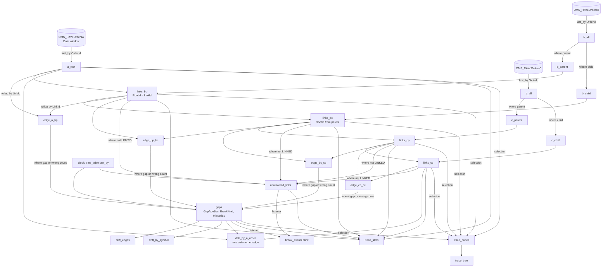

# 04 — The lineage and drift DAG

The Deephaven table graph that turns three raw tables into the doc 03 outputs for the
five-level chain `A_ROOT → B_PARENT → B_CHILD → C_PARENT → C_CHILD`. It is written for a
Core+ Python worker; every operation is Community Core, so the same code runs in a Community
server for the prototype (doc 10 M1) with the three source tables swapped.

The structure is the one the fix42 repo's doc 14 proved for Raptor → algo → router, which is
this topology one for one (client / algo parent / algo child / router parent / router child).
The production form below specializes it to the fixed five levels and joins on native id
columns (doc 02 D8). §8 shows how to run the generic `order_tree_recon` module instead.

---

## 1. Inputs, last state and the role split

```python
# oms-lineage PQ (Core+ Python). `db` is the worker's Enterprise database object.
import os
from deephaven import agg, merge, time_table

RAW_NS    = os.environ.get("OMS_TRACE_RAW_NAMESPACE", "OMS_RAW")
WINDOW    = int(os.environ.get("OMS_TRACE_DATE_WINDOW_DAYS", "2"))
AGE_SEC   = int(os.environ.get("OMS_TRACE_GAP_AGE_SEC", "30"))
UNRES_SEC = int(os.environ.get("OMS_TRACE_UNRESOLVED_ALERT_SEC", "3600"))
CLOCK     = os.environ.get("OMS_TRACE_CLOCK_SEC", "30")
PARENT_ID = os.environ.get("OMS_TRACE_PARENT_ID_COLUMN", "ParentOrderId")

def date_window(days: int) -> list[str]:
    """today-(days-1) .. today, plus tomorrow so the midnight rollover needs no restart."""
    from datetime import date, timedelta
    today = date.today()                       # the worker runs in OMS_TRACE_TZ (doc 07 §6)
    return [str(today + timedelta(d)) for d in range(-(days - 1), 2)]

DATES = ", ".join(f"`{d}`" for d in date_window(WINDOW))

def raw(table: str):
    # Partition filter first: the Date column prunes partitions before any row is read.
    return db.live_table(RAW_NS, table).where(f"Date in {DATES}")

def last_state(table: str):
    # One last_by per raw table (B and C hold two levels each): one row per order.
    return raw(table).last_by(["OrderId"])

IS_PARENT = f"isNull({PARENT_ID})"     # Q15: null = parent, non-null = child (doc 03 §3)

def canon(level: str, system: str, link: str | None):
    link_expr = "``" if link is None else f"isNull({link}) ? `` : {link}"
    return [
        f"Level = `{level}`", f"System = `{system}`",
        "OrderId",
        f"LinkId = {link_expr}",
        "Symbol = isNull(Symbol) ? `` : Symbol",
        "Side = isNull(Side) ? `` : Side",                # normalize here if codings differ (A7)
        "OrderQty = isNull(OrderQty) ? 0L : OrderQty",
        "CumQty = isNull(CumQty) ? 0L : CumQty",
        "LeavesQty = isNull(LeavesQty) ? 0L : LeavesQty",
        "Status = isNull(OrdStatus) ? `` : OrdStatus",
        "RecvTs",
        "Present = true",
    ]

a_all, b_all, c_all = last_state("OrdersA"), last_state("OrdersB"), last_state("OrdersC")

a_root   = a_all.view(canon("A_ROOT", "A", None))
b_parent = b_all.where(IS_PARENT).view(canon("B_PARENT", "B", "UpstreamRef"))
b_child  = b_all.where(f"!({IS_PARENT})").view(canon("B_CHILD", "B", PARENT_ID))
c_parent = c_all.where(IS_PARENT).view(canon("C_PARENT", "C", "UpstreamRef"))
c_child  = c_all.where(f"!({IS_PARENT})").view(canon("C_CHILD", "C", PARENT_ID))
```

Why `last_by` before the split and the `view`: the `view` is lazy and `last_by` only needs the
key column, so the adapter formulas are evaluated on one row per order rather than one per
message, and B's and C's two levels cost one pass each.

## 2. Link each level to its parent, top-down, carrying the root

```python
PARENT_COLS = [
    "ParentPresent = Present",
    "ParentCumQty = CumQty",
    "ParentSymbol = Symbol",
    "ParentSide = Side",
    "ParentStatus = Status",
    "ParentRecvTs = RecvTs",
    "ParentRootId = RootId",
]
STATE_COLS = [
    "ParentState = LinkId == `` ? `NO_LINK` : (isNull(ParentPresent) ? `UNRESOLVED` : `LINKED`)",
    "RootState = isNull(RootId) ? `UNRESOLVED` : `RESOLVED`",
    "UnresolvedSince = ParentState == `UNRESOLVED` ? RecvTs : null",
]

def link(children, parents, root_formula: str):
    return (
        children.natural_join(parents, on=["LinkId=OrderId"], joins=PARENT_COLS)
        .update_view([root_formula] + STATE_COLS)
    )

a_root   = a_root.update_view(["RootId = OrderId", "RootState = `RESOLVED`", "ParentState = `ROOT`"])
links_bp = link(b_parent, a_root,   "RootId = LinkId")        # the A id is known even before A arrives
links_bc = link(b_child,  links_bp, "RootId = ParentRootId")  # null while the B parent is missing
links_cp = link(c_parent, links_bc, "RootId = ParentRootId")
links_cc = link(c_child,  links_cp, "RootId = ParentRootId")
```

Four joins resolve every node's root. `natural_join` requires unique keys on the right;
`last_by("OrderId")` guarantees it. Should a feed violate A1 (two live orders with one id), the
join would throw and take the PQ down, so the adapter's `last_by` is also the guard that keeps
the DAG alive.

If A5 or A6 fail (rotating references, skipped hops), replace the single join per level with
doc 14's id index and ordered candidate parents (the generic path in §8).

## 3. Roll up direct children and compute the edge gap

```python
def children_rollup(children):
    return children.where("LinkId != ``").agg_by(
        [agg.count_("ChildCount"),
         agg.sum_(["ChildCumQty = CumQty"]),
         agg.max_(["ChildLastTs = RecvTs"])],
        by=["LinkId"],
    )

def edge(parents, children, name: str, scope: str, expect_one: bool):
    return (
        parents.natural_join(children_rollup(children), on=["OrderId=LinkId"],
                             joins=["ChildCount", "ChildCumQty", "ChildLastTs"])
        .update_view([
            "ChildCount = isNull(ChildCount) ? 0L : ChildCount",
            "ChildCumQty = isNull(ChildCumQty) ? 0L : ChildCumQty",
            "FillGap = CumQty - ChildCumQty",
            "LastChangeTs = isNull(ChildLastTs) || epochNanos(RecvTs) > epochNanos(ChildLastTs) ? RecvTs : ChildLastTs",
            f"Edge = `{name}`", f"Scope = `{scope}`", f"ExpectOne = {'true' if expect_one else 'false'}",
        ])
    )

edge_a_bp  = edge(a_root,   links_bp, "A-Bp",  "CROSS",    True)
edge_bp_bc = edge(links_bp, links_bc, "Bp-Bc", "INTERNAL", False)
edge_bc_cp = edge(links_bc, links_cp, "Bc-Cp", "CROSS",    True)
edge_cp_cc = edge(links_cp, links_cc, "Cp-Cc", "INTERNAL", False)
```

Only **direct** children are summed. Comparing A with Σ `C_CHILD` would count every
intermediate level's shares again; the four edge gaps telescope to the A-vs-street number
anyway (doc 03 §6), and each one names a book.

## 4. How a late parent heals (the replacement for the pending buffer)

Timeline for a C parent whose B child arrives two hours later:

| t | event | `links_cp` for Cp1 | `links_cc` for Cp1's children | `edge_bc_cp` | `unresolved_links` |
|---|---|---|---|---|---|
| T | Cp1 ingested (`LinkId = Bc1`), Cc rows ingested | `ParentState = UNRESOLVED`, `RootId = null` | `LINKED` to Cp1, `RootState = UNRESOLVED` | no Bc1 row | Cp1, age growing |
| T + 1 h | nothing | unchanged; `AgeSec` grows at each clock tick | unchanged | — | Cp1 `Alerted` after 3600 s |
| T + 2 h | Bc1 ingested | **modified** in the same cycle: `LINKED`, `RootId = A1` (from Bc1 → Bp1 → A1) | **modified**: `RootState = RESOLVED`, `RootId = A1` | Bc1 row added: `ChildCount = 1`, `FillGap = Bc1.CumQty − Cp1.CumQty` | Cp1 removed |
| T + 2 h | Bp1 already present | — | — | `edge_bp_bc` for Bp1 gains Bc1 in its rollup | — |

The `Cp-Cc` edge was reconciling the whole time: Cp1 against its children is local to C and
needs no B. Nothing was scheduled, re-read or re-published. The engine's join state is the
pending buffer, the raw `OrdersC` partition is its durable copy, and a lineage-PQ restart
replays the same healing by recomputing the joins over the window (doc 08 §3 R2).

What the window must cover: a parent that arrives on a later `Date` than its child links only
if both dates are in the window. `OMS_TRACE_DATE_WINDOW_DAYS` must exceed the maximum observed
lag at any hop (Q7); the default `2` covers an overnight lag.

## 5. Aging: transient lag is not drift

```python
# A slow clock, one row, re-ticks every OMS_TRACE_CLOCK_SEC seconds.
clock = time_table(f"PT{CLOCK}S").view(["Now = Timestamp"]).last_by()

# Age only the candidates: rows with a gap, or a 1:1 edge with the wrong child count.
# On a quiet book this is a few thousand rows, not the whole table.
candidates = merge([edge_a_bp, edge_bp_bc, edge_bc_cp, edge_cp_cc]).where(
    "FillGap != 0 || (ExpectOne && ChildCount != 1)"
)
gaps = (
    candidates
    .natural_join(clock, on=[], joins=["Now"])          # zero-key join onto the single clock row
    .update_view([
        "GapAgeSec = diffNanos(LastChangeTs, Now) / SECOND",
        f"BreakKind = CumQty > OrderQty ? `OVERFILL`"
        f" : GapAgeSec < {AGE_SEC} ? `TRANSIENT`"
        f" : (ExpectOne && ChildCount > 1) ? `CARDINALITY`"
        f" : (ExpectOne && ChildCount == 0 && CumQty == 0) ? `MISSING_CHILD`"
        f" : FillGap > 0 ? `MISSING_DOWNSTREAM` : (FillGap < 0 ? `UNBOOKED_UPSTREAM` : `NONE`)",
        "ShortSide = FillGap > 0 ? `CHILD` : `PARENT`",
        # CROSS edges: the short book belongs to the other system; INTERNAL: to this one.
        "MissedBy = Scope == `INTERNAL` ? System"
        " : (FillGap > 0 ? (Edge == `A-Bp` ? `B` : `C`) : (Edge == `A-Bp` ? `A` : `B`))",
        "IsDrift = BreakKind != `TRANSIENT` && BreakKind != `MISSING_CHILD` && BreakKind != `NONE`",
    ])
)

all_links = merge([links_bp, links_bc, links_cp, links_cc])
unresolved_links = (
    all_links.where("ParentState != `LINKED`")
    .natural_join(clock, on=[], joins=["Now"])
    .update_view(["AgeSec = diffNanos(RecvTs, Now) / SECOND", f"Alerted = AgeSec >= {UNRES_SEC}"])
)
root_unresolved = all_links.where("ParentState == `LINKED` && RootState == `UNRESOLVED`")
```

- `natural_join` with no key columns against a one-row table attaches the clock to every row;
  if the installed engine version rejects `on=[]`, `snapshot_when(clock)` on the candidate
  table gives the same effect at a slightly higher cost.
- The clock period bounds how late a gap is *declared* drift, not how fast it is detected.
- A gap closes when either side moves; the row leaves `gaps` and `break_events` records the
  `→ NONE` transition.

## 6. Aggregates

```python
drift_edges = gaps.where("IsDrift").view([
    "Edge", "Scope", "Level", "System", "OrderId", "RootId", "RootState", "Symbol", "Side", "Status",
    "OrderQty", "CumQty", "ChildCount", "ChildCumQty", "FillGap", "GapAgeSec", "BreakKind", "ShortSide", "MissedBy",
])

def gap_sum_by_root(edge_name: str, col: str):
    return (gaps.where(f"Edge == `{edge_name}` && IsDrift && !isNull(RootId)")
            .agg_by([agg.sum_([f"{col} = FillGap"]), agg.count_(f"{col}Breaks")], by=["RootId"]))

street_by_root = links_cc.where("!isNull(RootId)").agg_by([agg.sum_(["StreetCumQty = CumQty"])], by=["RootId"])
roots = a_root.view(["RootId", "Symbol", "Side", "ACumQty = CumQty"])

drift_by_a_order = (
    roots
    .natural_join(gap_sum_by_root("A-Bp",  "GapABp"),    on=["RootId"], joins=["GapABp", "GapABpBreaks"])
    .natural_join(gap_sum_by_root("Bp-Bc", "SumGapBpBc"), on=["RootId"], joins=["SumGapBpBc", "SumGapBpBcBreaks"])
    .natural_join(gap_sum_by_root("Bc-Cp", "SumGapBcCp"), on=["RootId"], joins=["SumGapBcCp", "SumGapBcCpBreaks"])
    .natural_join(gap_sum_by_root("Cp-Cc", "SumGapCpCc"), on=["RootId"], joins=["SumGapCpCc", "SumGapCpCcBreaks"])
    .natural_join(street_by_root, on=["RootId"], joins=["StreetCumQty"])
    .where("!isNull(GapABp) || !isNull(SumGapBpBc) || !isNull(SumGapBcCp) || !isNull(SumGapCpCc)")
    .update_view([
        "GapABp = isNull(GapABp) ? 0L : GapABp",
        "SumGapBpBc = isNull(SumGapBpBc) ? 0L : SumGapBpBc",
        "SumGapBcCp = isNull(SumGapBcCp) ? 0L : SumGapBcCp",
        "SumGapCpCc = isNull(SumGapCpCc) ? 0L : SumGapCpCc",
        "StreetCumQty = isNull(StreetCumQty) ? 0L : StreetCumQty",
        "MissingAtB = GapABp > 0 ? GapABp : 0L",
        "UnbookedAtA = GapABp < 0 ? -GapABp : 0L",
        "InternalB = SumGapBpBc",
        "MissingAtC = SumGapBcCp > 0 ? SumGapBcCp : 0L",
        "UnbookedAtB = SumGapBcCp < 0 ? -SumGapBcCp : 0L",
        "InternalC = SumGapCpCc",
        "Breaks = (isNull(GapABpBreaks) ? 0L : GapABpBreaks) + (isNull(SumGapBpBcBreaks) ? 0L : SumGapBpBcBreaks)"
        " + (isNull(SumGapBcCpBreaks) ? 0L : SumGapBcCpBreaks) + (isNull(SumGapCpCcBreaks) ? 0L : SumGapCpCcBreaks)",
    ])
)

drift_by_symbol = gaps.where("IsDrift").update_view([
    "MissingDownstream = FillGap > 0 ? FillGap : 0L",
    "UnbookedUpstream = FillGap < 0 ? -FillGap : 0L",
]).agg_by(
    [agg.count_("Breaks"),
     agg.sum_(["ParentCumQty = CumQty", "ChildCumQty", "MissingDownstream", "UnbookedUpstream"])],
    by=["Symbol", "Side", "Edge"],
)
```

`drift_by_a_order` only has rows for roots with aged drift somewhere below them; a root whose B
parent is missing (`A-Bp` has `ChildCount = 0`) appears with `MissingAtB = ACumQty` once aged,
which is the right reading. Gaps on nodes whose root is unresolved are counted in `drift_edges`
and `drift_by_symbol` but not here until the chain heals; `root_unresolved` lists them.

## 7. Transitions, stats and the UI slice

**Break events (blink).** A row per node whose `BreakKind` / `ParentState` changed. The exact
form is a Python `TableListener` on `gaps` and `unresolved_links` publishing
`(Ts, Level, System, OrderId, RootId, Edge, From, To, FillGap, GapAgeSec)` to a
`TablePublisher` blink table (the fix42 repo's listener pattern). The drift writer persists it
(doc 05 §8). The listener sees only the rows that changed in the cycle.

**`trace_stats`.** One-row `agg_by` tables per level and per edge joined into one row: node
counts, unresolved and alerted-unresolved counts, max unresolved age, gaps, drift, Σ
`MissingDownstream`, Σ `UnbookedUpstream`, and the 1 : 1 health counters `BChildren`,
`CParents`, `CParentsMinusBChildren` (the user's "C has as many parents as B has children",
as a number that should sit at zero once lag settles). It is what the alert sink and the
operations dashboard watch (doc 08 §2).

**UI slice.** The tree is built for a selection only (root ids from a `drift_by_a_order` row
press, a symbol, any order id resolved to its root), never for the whole book:

```python
UI_COLS = ["Level", "System", "OrderId", "LinkId", "Symbol", "Side", "Status", "OrderQty", "CumQty", "LeavesQty", "RootId"]

def lineage_nodes(root_ids):
    sel = ", ".join(f"`{r}`" for r in root_ids)
    parts = [
        a_root.where(f"RootId in {sel}").view(UI_COLS + ["NodeKey = `A|` + OrderId", "ParentKey = (String) null", "Depth = 0"]),
        links_bp.where(f"RootId in {sel}").view(UI_COLS + ["NodeKey = `B|` + OrderId", "ParentKey = `A|` + LinkId", "Depth = 1"]),
        links_bc.where(f"RootId in {sel}").view(UI_COLS + ["NodeKey = `B|` + OrderId", "ParentKey = `B|` + LinkId", "Depth = 2"]),
        links_cp.where(f"RootId in {sel}").view(UI_COLS + ["NodeKey = `C|` + OrderId", "ParentKey = `B|` + LinkId", "Depth = 3"]),
        links_cc.where(f"RootId in {sel}").view(UI_COLS + ["NodeKey = `C|` + OrderId", "ParentKey = `C|` + LinkId", "Depth = 4"]),
    ]
    nodes = merge(parts).natural_join(
        gaps.view(["Level", "OrderId", "FillGap", "BreakKind"]), on=["Level", "OrderId"], joins=["FillGap", "BreakKind"])
    return nodes, nodes.tree("NodeKey", "ParentKey", promote_orphans=True)
```

`promote_orphans=True` keeps an `UNRESOLVED` node visible at the top of the tree instead of
vanishing; the synthetic `NodeKey` strings exist only on these few hundred rows (D8). Nodes
with `RootState = UNRESOLVED` are not in a root's selection by definition; the "any order id"
search finds them through `all_links` and shows their partial subtree.

## 8. Running the generic module from the fix42 repo instead

`deephaven-fix42-dashboard/claude-code/order-tree-recon` implements §1–§7 for an N-level
topology with ordered candidate parents, an id index (every id a node was known by), a bounded
root walk with `TreePath`, the break taxonomy, a Python reference oracle and 138 tests — and
its **default topology is this one**: `CLIENT` = `A_ROOT`, `ALGO_PARENT` = `B_PARENT`,
`ALGO_CHILD` = `B_CHILD`, `OR_PARENT` = `C_PARENT`, `OR_CHILD` = `C_CHILD`. Only the adapters
differ:

```python
from order_tree_recon import config, dag

# parse_topology takes the same dict shape as config.DEFAULT_LEVELS; "parents" lists the
# systems a level's LinkId may resolve in, first match wins (add "A" after "B" for C_PARENT if Q5 says hops are skipped).
topology = config.parse_topology([
    {"name": "A_ROOT",   "system": "A"},
    {"name": "B_PARENT", "system": "B", "parents": ["A"]},
    {"name": "B_CHILD",  "system": "B", "parents": ["B"]},
    {"name": "C_PARENT", "system": "C", "parents": ["B"]},
    {"name": "C_CHILD",  "system": "C", "parents": ["C"], "street": True},
])
common = ["OrderId", "AltId = ``", "Moniker = ``", "Symbol", "Side", "OrderQty", "CumQty", "LeavesQty", "AvgPx", "Status = OrdStatus", "Destination = ``"]
tables = dag.build_order_tree(topology, {
    "A_ROOT":   a_all.view(["LinkId = ``"] + common),
    "B_PARENT": b_all.where(IS_PARENT).view(["LinkId = UpstreamRef"] + common),
    "B_CHILD":  b_all.where(f"!({IS_PARENT})").view([f"LinkId = {PARENT_ID}"] + common),
    "C_PARENT": c_all.where(IS_PARENT).view(["LinkId = UpstreamRef"] + common),
    "C_CHILD":  c_all.where(f"!({IS_PARENT})").view([f"LinkId = {PARENT_ID}"] + common),
})
# tables["otr_recon"].FillGap is doc 03's FillGap; UNBOOKED_FILL == UNBOOKED_UPSTREAM, PHANTOM_FILL ==
# MISSING_DOWNSTREAM; ORPHAN == UNRESOLVED; TOO_DEEP never fires on a fixed 5-level chain.
# LeavesQty -> 0 when the feed lacks it makes RouteGap/HELD meaningless; ignore them (or use them if Q14 says yes).
```

This is the recommended **M1 prototype**: adapters, mock data and the oracle for the chain
come almost for free, and the module's dashboard already shows the five-level tree with recon
columns. What the production form adds: the `Date` window, the aging clock (`TRANSIENT`), the
`CARDINALITY` / `MISSING_CHILD` checks, the Enterprise inputs, the blink transition table, and
native-id joins without `NodeKey` strings (the generic DAG allocates one string per node for its
key hash, ~8 GB at 100 M nodes; doc 06 §1).

## 9. The DAG as a graph



Every node is a join, a filter or an aggregation. When one `C_CHILD` fill ticks, the engine
recomputes that row, its `C_PARENT`'s rollup row, that edge row, the affected aggregate rows
and nothing else.

## 10. Checks the implementation must pass (doc 09 details them)

1. AC1–AC4 against the Python reference oracle, row for row, on the scenario catalog.
2. The telescoping identity over the four edges on every fully linked root (doc 03 §6).
3. The healing timeline of §4 under the embedded engine with keyed input tables as the raw
   tables, including `RootState` flipping on the `C_CHILD` rows.
4. `natural_join` never throws on duplicate right keys (the adapter `last_by` is in place).
5. The clock join evaluates only the candidate rows (assert the candidate table size in the
   1 M-node run).
6. The role split files a null parent id as a parent and any non-null one (an empty string
   included) as a child; an empty string surfaces as `NO_LINK`, never as a misfiled parent.
