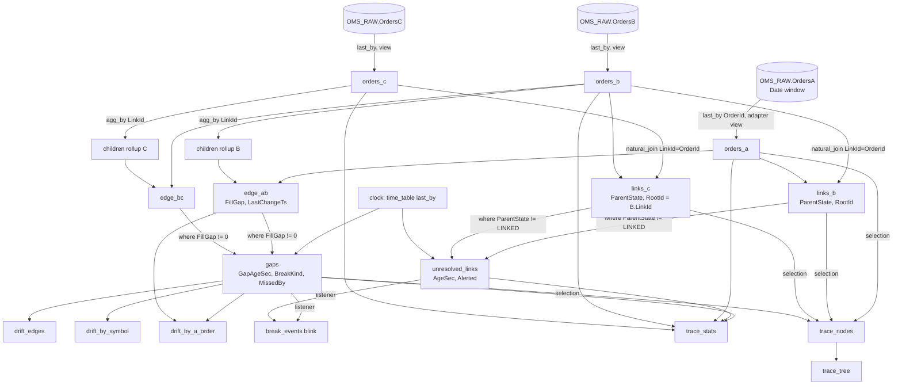

# 04 — The lineage and drift DAG

The Deephaven table graph that turns three raw tables into the doc 03 outputs. It is written
for a Core+ Python worker; every operation is Community Core, so the same code runs in a
Community server for the prototype (doc 10 M1) with the three source tables swapped.

The structure is the one the fix42 repo's doc 14 proved for Raptor → algo → router; the
production form below specializes it to a fixed three-level chain and joins on native id
columns (doc 02 D8). §8 shows how to reuse the generic `order_tree_recon` module instead.

---

## 1. Inputs and adapters

```python
# oms-lineage PQ (Core+ Python). `db` is the worker's Enterprise database object.
import os
from deephaven import agg, merge, time_table

RAW_NS   = os.environ.get("OMS_TRACE_RAW_NAMESPACE", "OMS_RAW")
WINDOW   = int(os.environ.get("OMS_TRACE_DATE_WINDOW_DAYS", "2"))
AGE_SEC  = int(os.environ.get("OMS_TRACE_GAP_AGE_SEC", "30"))
UNRES_SEC = int(os.environ.get("OMS_TRACE_UNRESOLVED_ALERT_SEC", "3600"))
CLOCK    = os.environ.get("OMS_TRACE_CLOCK_SEC", "30")

def date_window(days: int) -> list[str]:
    """today-(days-1) .. today, plus tomorrow so the midnight rollover needs no restart."""
    from datetime import date, timedelta
    today = date.today()                       # the worker runs in OMS_TRACE_TZ (doc 07 §6)
    return [str(today + timedelta(d)) for d in range(-(days - 1), 2)]

DATES = ", ".join(f"`{d}`" for d in date_window(WINDOW))

def raw(table: str):
    # Partition filter first: the Date column prunes partitions before any row is read.
    return db.live_table(RAW_NS, table).where(f"Date in {DATES}")

CANON = [
    "OrderId",
    "LinkId = isNull(UpstreamRef) ? `` : UpstreamRef",
    "Symbol = isNull(Symbol) ? `` : Symbol",
    "Side = isNull(Side) ? `` : Side",            # normalize here if codings differ (A7)
    "OrderQty = isNull(OrderQty) ? 0L : OrderQty",
    "CumQty = isNull(CumQty) ? 0L : CumQty",
    "LeavesQty = isNull(LeavesQty) ? 0L : LeavesQty",
    "Status = isNull(OrdStatus) ? `` : OrdStatus",
    "RecvTs",
    "Present = true",
]

def last_state(table: str, system: str):
    # last_by over the window: one row per order. Replace with the ingester's persisted
    # lastBy view (doc 05 §4.3) when the raw table is large.
    return raw(table).last_by(["OrderId"]).view([f"System = `{system}`"] + CANON)

orders_a = last_state("OrdersA", "A")
orders_b = last_state("OrdersB", "B")
orders_c = last_state("OrdersC", "C")
```

Why `last_by` before the adapter `view`: the `view` is lazy, and `last_by` only needs the key
column, so the adapter formulas are evaluated on one row per order rather than one per message.

## 2. Link children to parents

```python
PARENT_COLS = [
    "ParentPresent = Present",
    "ParentCumQty = CumQty",
    "ParentSymbol = Symbol",
    "ParentSide = Side",
    "ParentStatus = Status",
    "ParentRecvTs = RecvTs",
]
PARENT_STATE = (
    "ParentState = LinkId == `` ? `NO_LINK` : (isNull(ParentPresent) ? `UNRESOLVED` : `LINKED`)"
)

links_b = (
    orders_b.natural_join(orders_a, on=["LinkId=OrderId"], joins=PARENT_COLS)
    .update_view([PARENT_STATE, "RootId = LinkId",
                  "UnresolvedSince = ParentState == `UNRESOLVED` ? RecvTs : null"])
)

# C's root is its B parent's LinkId; it is null exactly while the B is unresolved.
links_c = (
    orders_c.natural_join(orders_b, on=["LinkId=OrderId"], joins=PARENT_COLS + ["RootId = LinkId"])
    .update_view([PARENT_STATE,
                  "UnresolvedSince = ParentState == `UNRESOLVED` ? RecvTs : null"])
)
```

`natural_join` requires unique keys on the right; `last_by("OrderId")` guarantees that. Should
a feed violate A1 (two live orders with one id), the join would throw and take the PQ down,
so the adapter's `last_by` is also the guard that keeps the DAG alive.

If A5 or A6 fail (rotating references, DMA-style skips), replace the single join with doc 14's
id index and ordered candidate parents: build `(System, Id) → OrderId` over every id a parent
was known by, and probe candidates in order (`B` then `A` for C). That is the generic path in
§8.

## 3. Roll up direct children and compute the edge gap

```python
def children_rollup(children):
    return children.where("LinkId != ``").agg_by(
        [agg.count_("ChildCount"),
         agg.sum_(["ChildCumQty = CumQty"]),
         agg.max_(["ChildLastTs = RecvTs"])],
        by=["LinkId"],
    )

EDGE_COLS = [
    "ChildCount = isNull(ChildCount) ? 0L : ChildCount",
    "ChildCumQty = isNull(ChildCumQty) ? 0L : ChildCumQty",
    "FillGap = CumQty - ChildCumQty",
    "LastChangeTs = isNull(ChildLastTs) || epochNanos(RecvTs) > epochNanos(ChildLastTs) ? RecvTs : ChildLastTs",
]

edge_ab = (
    orders_a.natural_join(children_rollup(orders_b), on=["OrderId=LinkId"],
                          joins=["ChildCount", "ChildCumQty", "ChildLastTs"])
    .update_view(EDGE_COLS + ["Edge = `AB`", "RootId = OrderId"])
)
edge_bc = (
    orders_b.natural_join(children_rollup(orders_c), on=["OrderId=LinkId"],
                          joins=["ChildCount", "ChildCumQty", "ChildLastTs"])
    .update_view(EDGE_COLS + ["Edge = `BC`", "RootId = LinkId"])
)
```

Only **direct** children are summed. Comparing A with Σ C would count B's shares twice when
B both executes and routes; the per-edge gaps telescope to the A-vs-C number anyway (doc 03
§6).

## 4. How a late parent heals (the replacement for the pending buffer)

Timeline for a C row whose B arrives two hours later:

| t | event | `links_c` row for C1 | `edge_bc` | `unresolved_links` |
|---|---|---|---|---|
| T | C1 ingested (`LinkId = B1`) | added: `ParentState = UNRESOLVED`, `RootId = null`, `UnresolvedSince = T` | no B1 row | C1, age growing |
| T + 1 h | nothing | unchanged; `AgeSec` grows at each clock tick | — | C1 `Alerted = true` after 3600 s |
| T + 2 h | B1 ingested | **modified** in the same update cycle: `ParentState = LINKED`, `RootId = A1`, parent columns filled | B1 row added with `ChildCount = 1`, `ChildCumQty = C1.CumQty`, `FillGap = B1.CumQty − C1.CumQty` | C1 removed |
| T + 2 h + ε | A1 was already present | `links_b` for B1 is `LINKED` | `edge_ab` for A1 gains B1 in its rollup | — |

Nothing was scheduled, re-read or re-published. The engine's join state is the pending buffer,
the raw `OrdersC` partition is its durable copy, and a lineage-PQ restart replays the same
healing by recomputing the joins over the window (doc 08 §3 R2).

What the window must cover: a B that arrives on a later `Date` than its C links only if both
dates are in the window. `OMS_TRACE_DATE_WINDOW_DAYS` must therefore exceed the maximum
observed lag (Q7); the default `2` covers an overnight lag. Lag beyond the window shows as a
permanently `UNRESOLVED` child in the earlier day's window, which the alert catches.

## 5. Aging: transient lag is not drift

```python
# A slow clock, one row, re-ticks every OMS_TRACE_CLOCK_SEC seconds.
clock = time_table(f"PT{CLOCK}S").view(["Now = Timestamp"]).last_by()

# Age only the candidates: rows with a gap or without a parent. On a quiet book this is a
# few thousand rows, not the whole table, so the per-tick re-evaluation is cheap.
gaps = (
    merge([edge_ab, edge_bc]).where("FillGap != 0")
    .natural_join(clock, on=[], joins=["Now"])          # zero-key join onto the single clock row
    .update_view([
        "GapAgeSec = diffNanos(LastChangeTs, Now) / SECOND",
        f"BreakKind = CumQty > OrderQty ? `OVERFILL`"
        f" : GapAgeSec < {AGE_SEC} ? `TRANSIENT`"
        f" : FillGap > 0 ? `MISSING_DOWNSTREAM` : `UNBOOKED_UPSTREAM`",
        "MissedBy = FillGap > 0 ? (Edge == `AB` ? `B` : `C`) : (Edge == `AB` ? `A` : `B`)",
        "IsDrift = BreakKind != `TRANSIENT`",
    ])
)

unresolved_links = (
    merge([links_b, links_c]).where("ParentState != `LINKED`")
    .natural_join(clock, on=[], joins=["Now"])
    .update_view(["AgeSec = diffNanos(RecvTs, Now) / SECOND",
                  f"Alerted = AgeSec >= {UNRES_SEC}"])
)
```

- `natural_join` with no key columns against a one-row table attaches the clock to every row;
  if the installed engine version rejects `on=[]`, `snapshot_when(clock)` on the candidate
  table gives the same effect at a slightly higher cost.
- The clock period (30 s) bounds how late a gap is *declared* drift, not how fast it is
  detected; the gap row itself exists the instant it opens.
- A gap closes when either side moves; the row leaves `gaps` and, if it was drift, `break_events`
  records the `→ NONE` transition.

## 6. Aggregates

```python
drift_edges = gaps.where("IsDrift").view([
    "Edge", "System", "OrderId", "RootId", "Symbol", "Side", "Status", "OrderQty", "CumQty",
    "ChildCount", "ChildCumQty", "FillGap", "GapAgeSec", "BreakKind", "MissedBy",
])

# Per root A order: the AB gap is keyed by the A id already; BC gaps are summed by B's A ref.
bc_by_root = gaps.where("Edge == `BC` && IsDrift").agg_by(
    [agg.sum_(["SumGapBC = FillGap", "SumCCumQty = ChildCumQty"]), agg.count_("BcBreaks")],
    by=["RootId"],
)
drift_by_a_order = (
    edge_ab.view(["RootId", "Symbol", "Side", "ACumQty = CumQty", "SumBCumQty = ChildCumQty", "GapAB = FillGap"])
    .natural_join(gaps.where("Edge == `AB` && IsDrift").view(["RootId", "AbDrift = FillGap"]),
                  on=["RootId"], joins=["AbDrift"])
    .natural_join(bc_by_root, on=["RootId"], joins=["SumGapBC", "SumCCumQty", "BcBreaks"])
    .where("!isNull(AbDrift) || !isNull(SumGapBC)")
    .update_view([
        "GapAB = isNull(AbDrift) ? 0L : AbDrift",
        "SumGapBC = isNull(SumGapBC) ? 0L : SumGapBC",
        "MissingAtB = GapAB > 0 ? GapAB : 0L",
        "UnbookedAtA = GapAB < 0 ? -GapAB : 0L",
        "MissingAtC = SumGapBC > 0 ? SumGapBC : 0L",
        "UnbookedAtB = SumGapBC < 0 ? -SumGapBC : 0L",
        "Breaks = (isNull(AbDrift) ? 0 : 1) + (isNull(BcBreaks) ? 0 : BcBreaks)",
    ])
)

drift_by_symbol = gaps.where("IsDrift").update_view([
    "MissingDownstream = FillGap > 0 ? FillGap : 0L",
    "UnbookedUpstream = FillGap < 0 ? -FillGap : 0L",
]).agg_by(
    [agg.count_("Breaks"),          # parents with aged drift; the table is already drift-only
     agg.sum_(["ParentCumQty = CumQty", "ChildCumQty", "MissingDownstream", "UnbookedUpstream"])],
    by=["Symbol", "Side", "Edge"],
)
```

`drift_by_a_order` uses the raw `GapAB` only when it is drift, so a transient gap on the A–B
edge does not create a row; `SumBCumQty` and `ACumQty` are the live values for context.

## 7. Transitions, stats and the UI slice

**Break events (blink).** A row per node whose `BreakKind`/`ParentState` changed. The
simplest exact form is a Python `TableListener` on `gaps` and `unresolved_links` that publishes
`(Ts, System, OrderId, RootId, Edge, From, To, FillGap, GapAgeSec)` to a `TablePublisher`
blink table — the fix42 repo's `fix42cache` listener pattern. The drift writer persists it
(doc 05 §8). Keep the listener tiny: it sees only the rows that changed in the cycle.

**`trace_stats`.** One-row `agg_by` tables per system and per edge, joined into one row:
counts of orders, unresolved, alerted-unresolved, gaps, drift, Σ `MissingDownstream`,
Σ `UnbookedUpstream`, max unresolved age, the window dates and the worker's last cycle time.
It is what the alert sink and the operations dashboard watch (doc 08 §2).

**UI slice.** The tree is built only for a selection (a root id, a symbol, a `drift_edges`
row press), never for the whole book:

```python
def lineage_nodes(root_ids):           # called by the dashboard with the selected roots
    sel = ", ".join(f"`{r}`" for r in root_ids)
    a = orders_a.where(f"OrderId in {sel}").view(CANON_UI + ["NodeKey = `A|` + OrderId", "ParentKey = (String) null", "Depth = 0"])
    b = links_b.where(f"RootId in {sel}").view(CANON_UI + ["NodeKey = `B|` + OrderId", "ParentKey = `A|` + LinkId", "Depth = 1"])
    c = links_c.where(f"RootId in {sel}").view(CANON_UI + ["NodeKey = `C|` + OrderId", "ParentKey = `B|` + LinkId", "Depth = 2"])
    nodes = merge([a, b, c]).natural_join(gaps.view(["System", "OrderId", "FillGap", "BreakKind"]),
                                          on=["System", "OrderId"], joins=["FillGap", "BreakKind"])
    return nodes, nodes.tree("NodeKey", "ParentKey", promote_orphans=True)
```

`promote_orphans=True` keeps an `UNRESOLVED` C visible at the top level of the tree instead of
vanishing; the synthetic `NodeKey` strings exist only on these few hundred rows (D8).

## 8. Reusing the generic module from the fix42 repo

`deephaven-fix42-dashboard/claude-code/order-tree-recon` already implements §1–§7 for an
N-level topology with ordered candidate parents, an id index, `TreePath`, the break taxonomy,
a Python reference oracle and 138 tests. For the prototype and for the UI slice, configure it
as a three-level chain:

```python
from order_tree_recon import config, dag

# parse_topology takes the same dict shape as config.DEFAULT_LEVELS; "parents" lists the
# systems a level's LinkId may resolve in, first match wins (add "A" after "B" for C if Q5 says DMA).
topology = config.parse_topology([
    {"name": "A_ORDER", "system": "A"},
    {"name": "B_ORDER", "system": "B", "parents": ["A"]},
    {"name": "C_ORDER", "system": "C", "parents": ["B"], "street": True},
])
tables = dag.build_order_tree(topology, {
    "A_ORDER": orders_a.view(ADAPTER_A),   # CANONICAL_COLUMNS: OrderId, AltId, LinkId, Moniker, Symbol, Side, OrderQty, CumQty, LeavesQty, AvgPx, Status, Destination
    "B_ORDER": orders_b.view(ADAPTER_B),
    "C_ORDER": orders_c.view(ADAPTER_C),
})
# tables["otr_recon"].FillGap is doc 03's FillGap; BreakKind UNBOOKED_FILL == UNBOOKED_UPSTREAM,
# PHANTOM_FILL == MISSING_DOWNSTREAM. Moniker -> "" (A has no moniker here); LeavesQty -> 0 when
# the feed lacks it, which makes RouteGap/HELD meaningless and they are ignored.
```

What the generic module does not have and the production form adds: the `Date` window, the
aging clock (`TRANSIENT`), the Enterprise inputs, the blink transition table, and native-id
joins without `NodeKey` strings (the generic DAG allocates one string per node, which at
100 M nodes is ~8 GB; doc 06 §1).

## 9. The DAG as a graph



Every node is a join, a filter or an aggregation. When one C fill ticks, the engine recomputes
that C row, its B parent's rollup row, that edge row, the affected aggregate rows and nothing
else.

## 10. Checks the implementation must pass (doc 09 details them)

1. AC1–AC4 against the Python reference oracle, row for row, on the scenario catalog.
2. The telescoping identity on every fully linked root (doc 03 §6).
3. The healing timeline of §4 under the embedded engine with a keyed input table as `OrdersB`.
4. `natural_join` never throws on duplicate right keys (the adapter `last_by` is in place).
5. The clock join evaluates only `where("FillGap != 0")` rows (assert the candidate table size
   in the 1 M-row run).
